<picture>
  <source media="(prefers-color-scheme: dark)" srcset="./card-dark.svg">
  
</picture>

 
 

  <a href="https://shubham-prasad.vercel.app/">
    <strong>🌐 Explore my portfolio ↗</strong>
  </a>

 

I like turning hard ideas into things people can actually use: AI tools that read whole codebases, databases that enforce their own rules, and small games that teach you something in a few seconds. Most days you'll find me somewhere between a backend, a database and a LeetCode contest.

## 🚀 Featured projects

### 🌟 [Zenoryx](https://github.com/ivruhs/Zenoryx) · AI code assistant · [live ↗](https://zenoryx.vercel.app/)

> Chat with any GitHub repository and understand a large codebase in minutes.

- **Repo-scale RAG:** code is split by its syntax tree with Tree-sitter, so every chunk is a whole function or class
- **Semantic search** over those chunks with pgvector embeddings
- **Background indexing** on BullMQ + Redis, so big repos never block the chat
- AI explanations and repo insights from Gemini

Next.js 15 · Express · BullMQ · Redis · Tree-sitter · pgvector · Gemini

### 📊 [LeetCode Post-Mortem](https://github.com/ivruhs/lc_postmortem) · contest analytics · [live ↗](https://lc-postmortem.vercel.app/)

> Replay your contest minute by minute and see exactly where the rank went.

- Processes **40,000+ submissions** into a rank trajectory in **O(N)**
- A **"what if" rank simulator** on a binary-search analytics engine
- A custom gzip pipeline that cut serverless costs by **85%**

Next.js · TypeScript · Upstash Redis

### 🗄️ [CONCOURS](https://github.com/ivruhs/dbms_project_concours) · tournament management system

> A sports tournament system where the database itself enforces the rules.

- **23 BCNF-compliant tables**, designed from scratch
- Business rules held by **stored procedures, functions and triggers**, not app code
- **Natural language → SQL**: ask a question in plain English, get the query back
- Automated tournament scheduling

PostgreSQL · PL/pgSQL · Next.js · AI

## 🎮 Part-time at [wundr.fun](https://wundr.fun)

Wundr is a mobile feed of tiny interactive games, each one leaving a single idea behind. The anti-doomscroll feed.

- **Games:** I've made 30+ for the feed, like [Slice](https://wundr.fun/w/slice), [Galla](https://wundr.fun/w/galla), [Sikku](https://wundr.fun/w/sikku) and a [Diwali set](https://wundr.fun/c/diwali), some in real-time 3D with three.js
- **Backend:** the system that ships new games without an app update (Postgres + a CDN, with versions and rollback), and work on the feed's recommendation engine
- **App and share:** an Expo / React Native upgrade, and share videos rebuilt on WebCodecs

TypeScript · React · Hono · Postgres · Expo · three.js · Playwright

## 🛠 Toolbox

   
  

Also: Gemini · OpenAI · RAG · pgvector · BullMQ · Tree-sitter · Drizzle · Expo

## 🏅 Highlights

| | |
|:-:|---|
| 🏆 | **Google Big Code**, Round 2 qualifier (top 1500 in India) |
| ⭐ | **LeetCode Knight**: 1850+ rating, 600+ problems solved |
| 👨‍💻 | **Core member**, Microsoft Student Technical Club (MSTC) |
| 🎯 | **JEE Main** AIR 8,668 · **JEE Advanced** AIR 13,830 |

## 🌱 Right now

- 📚 **Learning:** AI agents and multi-agent systems, system design, distributed systems, high-performance databases
- 🎬 **Off the clock:** a good TV series, reading about AI, and one more side project

## 📫 Find me

